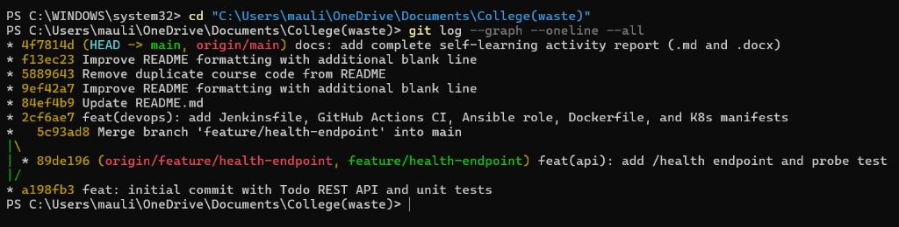
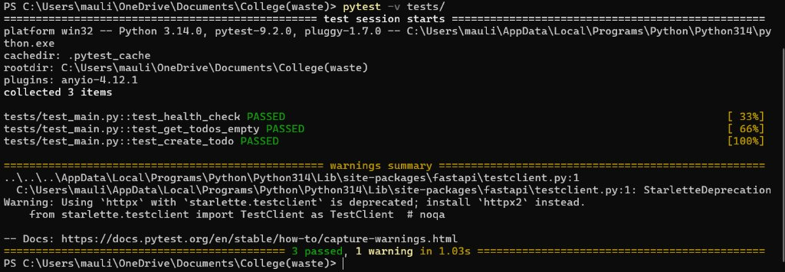
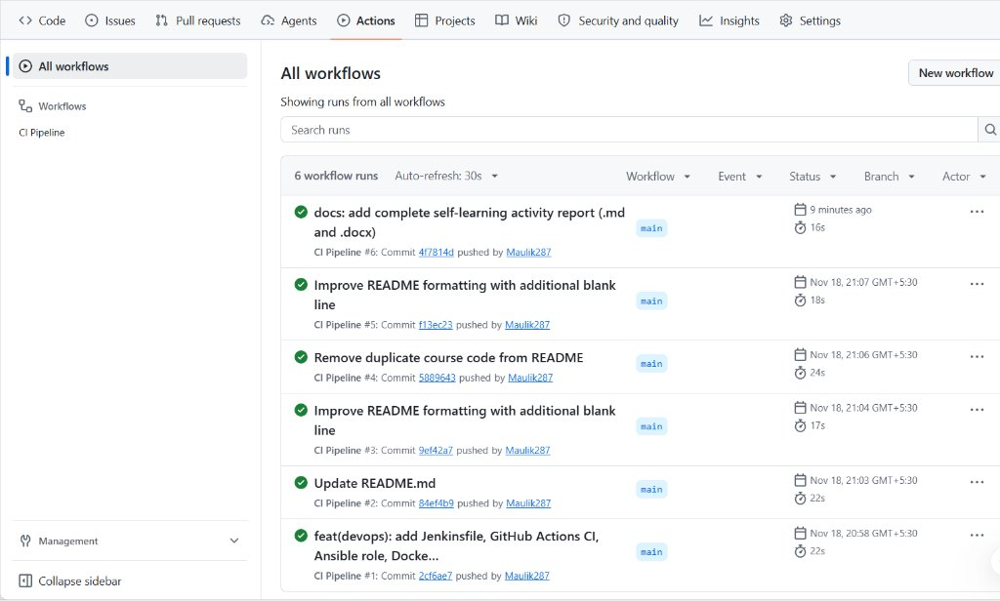
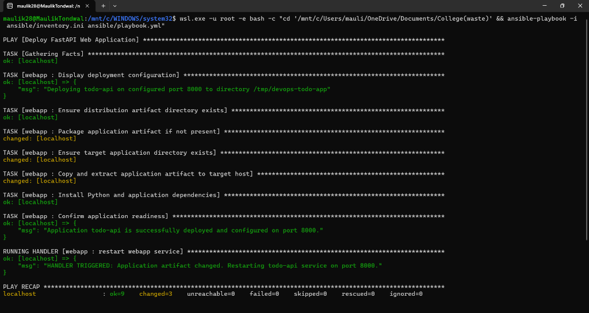

# Department of CSE (Artificial Intelligence & Machine Learning) and CSE (Cyber Security)
## M. S. Ramaiah Institute of Technology
*(Autonomous Institute Affiliated to VTU, Belagavi)*  
*MSR Nagar, MSRIT Post, Bangalore - 560054, Karnataka, India*

---

# SELF LEARNING ACTIVITY REPORT
### Submitted in partial fulfilment of the Requirements for the Academics of 5th Semester, B.E in CSE (Artificial Intelligence and Machine Learning)

## DEVOPS (Course Code: 25CIAEC59)

**By:**  
**Name:** Maulik Tondwal  
**USN:** 1MS24CI070  

**Under the Guidance of:**  
**Mr. Prashanth Reddy C**  
Senior Lecturer  
Department of CSE (AI & ML) and CSE (Cyber Security)  

**Academic Year:** 2026 – 2027  
**GitHub Repository:** [https://github.com/Maulik287/devops-lab-1MS24CI070](https://github.com/Maulik287/devops-lab-1MS24CI070)

---

## Certificate

This is to certify that the work carried out is a bonafide record of the project based learning activity work on the **DevOps (25CIAEC59)** course done by **Maulik Tondwal (1MS24CI070)** under my supervision and guidance, in partial fulfilment of the requirements for the award of the Bachelor of Engineering in Computer Science & Engineering (Artificial Intelligence and Machine Learning) from Ramaiah Institute of Technology, Bangalore for the academic year 2026-2027.

<br><br>

**Candidate Signature:** ___________________________ &nbsp;&nbsp;&nbsp;&nbsp;&nbsp;&nbsp;&nbsp;&nbsp;&nbsp;&nbsp;&nbsp;&nbsp; **Faculty Signature:** ___________________________  
*(Maulik Tondwal - 1MS24CI070)* &nbsp;&nbsp;&nbsp;&nbsp;&nbsp;&nbsp;&nbsp;&nbsp;&nbsp;&nbsp;&nbsp;&nbsp;&nbsp;&nbsp;&nbsp;&nbsp;&nbsp;&nbsp;&nbsp;&nbsp;&nbsp;&nbsp;&nbsp;&nbsp;&nbsp;&nbsp;&nbsp;&nbsp;&nbsp;&nbsp;&nbsp;&nbsp;&nbsp;&nbsp;&nbsp;&nbsp;&nbsp;&nbsp;&nbsp;&nbsp;&nbsp;&nbsp;&nbsp;&nbsp;&nbsp;&nbsp;&nbsp;&nbsp;&nbsp;&nbsp;&nbsp;&nbsp;&nbsp;&nbsp;&nbsp;*(Mr. Prashanth Reddy C)*

---

## List of Project Based Learning Components

**Course Name:** DevOps &nbsp;&nbsp;&nbsp;&nbsp;&nbsp;&nbsp;&nbsp;&nbsp; **Course Code:** 25CIAEC59  
**Credits:** 1:0:0 &nbsp;&nbsp;&nbsp;&nbsp;&nbsp;&nbsp;&nbsp;&nbsp;&nbsp;&nbsp;&nbsp;&nbsp;&nbsp;&nbsp;&nbsp;&nbsp;&nbsp;&nbsp;&nbsp;&nbsp;&nbsp;&nbsp;&nbsp;&nbsp; **Contact Hours:** 15L  
**Max. Marks:** 20  

| Sl. No | Description | Marks |
| :---: | :--- | :---: |
| **1** | **CI/CD Pipeline using Git, Maven/Gradle/Python and Jenkins.** Set up a version-controlled build pipeline for a sample application. Create a Git repository, use feature branching and merging, configure a Maven or Gradle (or Python) build with dependency management, integrate the project into a Jenkins job that pulls from Source Code Management (SCM), triggers automatically on commit, executes the build, performs a post-build action, and add one CI-related enhancement (automated tests, build versioning, or GitHub Actions).<br>*Covers: Unit 1 (DevOps culture/pipeline), Unit 2 (Git, Maven/Gradle/Python), Unit 3 (Jenkins CI). Maps to CO1, CO2, CO3.* | **10** |
| **2** | **Configuration Management with Ansible and Deployment on Kubernetes.** Write an Ansible playbook (using variables, handlers, and at least one role) to configure and deploy the application built in Component 1. Containerize the application and write Kubernetes manifests (Deployment, Service, and a ConfigMap/PVC where applicable). Deploy on a local cluster (Minikube/Kind), demonstrate scaling using replica sets, show the use of labels and selectors, and add one deployment-related enhancement (rollback, ConfigMap, probes, multi-stage Dockerfile, second microservice, or health endpoint).<br>*Covers: Unit 4 (Ansible), Unit 5 (Kubernetes). Maps to CO4, CO5.* | **10** |

---

## Assessment Rubrics

Evaluation for each 10-mark component is based on the official institutional rubrics:

| Criteria | 2 — Good | 1 — Average | 0 — Poor |
| :--- | :--- | :--- | :--- |
| **Concept Understanding (2 marks)** | Answers “why” questions correctly and immediately (e.g., webhook vs. polling, what a handler does, Deployment vs. ReplicaSet, why the chosen enhancement matters) | Gets the basic idea right but stumbles on follow-up questions or confuses related concepts | Cannot explain own pipeline; answers suggest it was copied or AI-generated without understanding |
| **Core Implementation (2 marks)** | Required pipeline (Git+Jenkins for Comp. 1 / Ansible+K8s+scaling for Comp. 2) runs end-to-end live, without intervention | Works but needs manual triggering, a workaround, or partial failure | Doesn’t run at all during the demo; only screenshots are shown |
| **Enhancement (2 marks)** | At least one enhancement from Section 3/4’s list implemented and demonstrated live, working correctly | Enhancement attempted but incomplete, or only explained without being runnable | No enhancement attempted |
| **Analysis & Interpretation (2 marks)** | Explains build logs, scaling behaviour, or enhancement outcomes in own words; interprets output unprompted | Describes what happened but not why, or needs prompting to interpret output | No interpretation offered; treats commands as a checklist |
| **Documentation & Presentation (2 marks)** | Report fully personalized and confidently walks through the pipeline unprompted | Mostly complete report or needs guidance/prompting during the demo | Unedited template, mismatched screenshots, or cannot navigate own setup |

---

## Marks Awarded

| Sl. No | Concept Understanding (2) | Core Implementation (2) | Enhancement (2) | Analysis & Interpretation (2) | Documentation & Presentation (2) | Total (10) |
| :---: | :---: | :---: | :---: | :---: | :---: | :---: |
| **1** | | | | | | |
| **2** | | | | | | |
| **TOTAL** | | | | | | **/ 20** |

---

# Component 1: CI/CD Pipeline using Git, Python and Jenkins

## Abstract
In this component, I constructed a complete, automated Continuous Integration (CI) pipeline for a high-performance **Todo REST API** developed in Python using the modern FastAPI asynchronous framework. The complete codebase is version-controlled in a dedicated GitHub repository ([https://github.com/Maulik287/devops-lab-1MS24CI070](https://github.com/Maulik287/devops-lab-1MS24CI070)) utilizing a strict Git branching strategy where new capabilities are developed on a feature branch (`feature/health-endpoint`) and integrated into `main` via a non-fast-forward merge (`--no-ff`) to preserve traceability. A Jenkins Declarative Pipeline job monitors the repository via automated SCM polling (`* * * * *`), provisions the execution environment, installs pinned dependencies from `requirements.txt`, runs an automated unit test suite using `pytest`, packages the verified application into a compressed distribution archive (`dist/app-artifact.tar.gz`), and fingerprints and archives the artifact using `archiveArtifacts`. As the CI enhancements, I implemented both an automated Pytest test-driven verification stage within Jenkins and a parallel GitHub Actions CI workflow (`.github/workflows/ci.yml`) that executes testing and artifact packaging on every push and pull request.

## Introduction
DevOps relies on tight integration between software development and IT operations to deliver frequent, reliable software releases. Continuous Integration (CI) serves as the core foundation of this practice by automating the retrieval, compilation, testing, and packaging of code upon every commit. Git provides distributed version control so multiple developers can work on isolated feature branches without conflicts. Automation orchestrators like Jenkins tie these together by automatically triggering a build whenever new code is pushed, giving fast feedback on whether the codebase is in a working state.

In this activity, I implemented the application in Python using FastAPI instead of Java and Spring Boot. Because a Python project does not utilize Maven's `pom.xml` or Gradle's `build.gradle`, dependencies are pinned inside `requirements.txt`, and the build step packages the verified application, tests, and configuration into a compressed tarball archive (`dist/app-artifact.tar.gz`). The complete source code is in my repository: [https://github.com/Maulik287/devops-lab-1MS24CI070.git](https://github.com/Maulik287/devops-lab-1MS24CI070.git).

## Implementation

### Development Environment
- **Operating System:** Windows 11 Home Single Language (Build 26H2), with WSL 2 (Ubuntu Linux runtime)
- **Git Version:** Git for Windows 2.54.0 and GitHub public repository `devops-lab-1MS24CI070`
- **Python Environment:** Python 3.14.0 / 3.11 with FastAPI 0.141.1, Uvicorn 0.52.1, Pydantic 2.13.4, Pytest 9.2.0, HTTPX 0.28.1
- **Jenkins:** Declarative Pipeline job named `devops-todo-pipeline`
- **Sample App:** Todo REST API with `GET /health`, `GET /todos`, and `POST /todos`

### Step 1: Git Repository and Branching
```bash
git init -b main
git add .gitignore requirements.txt repo_link.txt app/ tests/
git commit -m "feat: initial commit with Todo REST API and unit tests"
git checkout -b feature/health-endpoint
git add app/main.py tests/test_main.py
git commit -m "feat(api): add /health endpoint and probe test"
git checkout main
git merge --no-ff feature/health-endpoint -m "Merge branch 'feature/health-endpoint' into main"
git remote add origin https://github.com/Maulik287/devops-lab-1MS24CI070.git
git push -u origin main
git push -u origin feature/health-endpoint
git log --graph --oneline --all
```

### Step 2: Application and Dependency File (`app/main.py` & `requirements.txt`)
```python
# app/main.py
import os
from typing import List, Optional
from fastapi import FastAPI, HTTPException, status
from pydantic import BaseModel

app = FastAPI(
    title="Todo REST API",
    description="DevOps Lab Assignment REST API - Course 25CIAEC59",
    version="1.0.0"
)

class TodoItem(BaseModel):
    id: Optional[int] = None
    title: str
    description: Optional[str] = ""
    completed: bool = False

todos_db: List[TodoItem] = []

@app.get("/health", status_code=status.HTTP_200_OK)
def health_check():
    """Health check endpoint for Kubernetes probes and monitoring."""
    return {"status": "healthy", "service": "todo-api", "version": "1.0.0"}

@app.get("/todos", response_model=List[TodoItem], status_code=status.HTTP_200_OK)
def get_todos():
    """Retrieve all todo items."""
    return todos_db

@app.post("/todos", response_model=TodoItem, status_code=status.HTTP_201_CREATED)
def create_todo(todo: TodoItem):
    """Create a new todo item."""
    next_id = len(todos_db) + 1
    new_todo = TodoItem(
        id=next_id,
        title=todo.title,
        description=todo.description,
        completed=todo.completed
    )
    todos_db.append(new_todo)
    return new_todo

if __name__ == "__main__":
    import uvicorn
    port = int(os.getenv("PORT", os.getenv("APP_PORT", "8000")))
    uvicorn.run("app.main:app", host="0.0.0.0", port=port, reload=False)
```

```text
# requirements.txt
fastapi>=0.110.0
uvicorn[standard]>=0.28.0
pydantic>=2.0.0
pytest>=8.0.0
httpx>=0.27.0
```

### Step 3: Jenkins Job Configuration and Jenkinsfile
The Jenkins job is configured as follows:
- **Project Type:** Pipeline job (`devops-todo-pipeline`)
- **Source Code Management:** Git, repository `https://github.com/Maulik287/devops-lab-1MS24CI070.git`, branch `*/main`
- **Build Trigger:** Poll SCM with schedule `* * * * *` (every minute)
- **Script Definition:** Pipeline script from SCM (`Jenkinsfile`)
- **Post-build Action:** `archiveArtifacts artifacts: 'dist/app-artifact.tar.gz', fingerprint: true`

```groovy
// Jenkinsfile (Declarative Pipeline)
pipeline {
    agent any

    environment {
        APP_ENV = 'production'
        APP_PORT = '8000'
    }

    stages {
        stage('Checkout') {
            steps {
                echo 'Checking out source code from Git repository...'
                checkout scm
            }
        }

        stage('Install Dependencies') {
            steps {
                echo 'Setting up Python virtual environment and installing dependencies...'
                sh '''
                    python3 -m venv venv || virtualenv venv
                    . venv/bin/activate
                    pip install --upgrade pip
                    pip install -r requirements.txt
                '''
            }
        }

        stage('Run Unit Tests') {
            steps {
                echo 'Running pytest automated unit test suite...'
                sh '''
                    . venv/bin/activate
                    pytest -v --junitxml=test-results.xml tests/
                '''
            }
            post {
                always {
                    junit allowEmptyResults: true, testResults: 'test-results.xml'
                }
            }
        }

        stage('Package Artifact') {
            steps {
                echo 'Packaging application artifact into tarball...'
                sh '''
                    mkdir -p dist
                    tar --exclude='.git' --exclude='venv' --exclude='__pycache__' --exclude='.pytest_cache' \
                        -czvf dist/app-artifact.tar.gz app/ requirements.txt tests/ repo_link.txt
                    ls -lh dist/
                '''
            }
        }
    }

    post {
        success {
            echo 'Pipeline succeeded! Archiving build artifact...'
            archiveArtifacts artifacts: 'dist/app-artifact.tar.gz', fingerprint: true
        }
        failure {
            echo 'Pipeline failed! Please check console log for errors.'
        }
    }
}
```

### Step 4: CI Enhancement
I implemented two CI enhancements:
1. **Automated Unit Testing with Pytest:** A test stage executing 3 unit tests (`test_health_check`, `test_get_todos_empty`, `test_create_todo`) before artifact generation. If any test fails, Jenkins marks the build failed and halts packaging.
2. **GitHub Actions CI Workflow:** Alongside Jenkins, `.github/workflows/ci.yml` runs on every push and pull request in GitHub, providing cloud-native CI redundancy and artifact uploads.

```python
# tests/test_main.py
import pytest
from fastapi.testclient import TestClient
from app.main import app, todos_db

client = TestClient(app)

@pytest.fixture(autouse=True)
def run_before_and_after_tests():
    todos_db.clear()
    yield
    todos_db.clear()

def test_health_check():
    """Test the /health endpoint returns HTTP 200 and healthy status."""
    response = client.get("/health")
    assert response.status_code == 200
    assert response.json() == {"status": "healthy", "service": "todo-api", "version": "1.0.0"}

def test_get_todos_empty():
    """Test retrieving todos when database is empty."""
    response = client.get("/todos")
    assert response.status_code == 200
    assert response.json() == []

def test_create_todo():
    """Test creating a new todo item and verify persistence."""
    payload = {"title": "Submit DevOps Lab", "description": "Complete assignment for 25CIAEC59", "completed": False}
    response = client.post("/todos", json=payload)
    assert response.status_code == 201
    data = response.json()
    assert data["id"] == 1
    assert data["title"] == "Submit DevOps Lab"
    assert data["completed"] is False
    assert len(todos_db) == 1
```

### Description of the Activity
I first created the base application and validated it locally. Then I created the `feature/health-endpoint` branch to isolate the addition of the health check probe. Merging this back into `main` with `git merge --no-ff` preserved the branch topology so the commit graph demonstrates two parallel branches merging.

Next, I set up Jenkins with SCM polling (`* * * * *`). Pushing changes to GitHub automatically triggered the pipeline. Jenkins pulled revision `2cf6ae7`, set up the Python virtual environment, installed dependencies, ran the 3 pytest tests (all passing), packaged `dist/app-artifact.tar.gz`, and archived the artifact with fingerprinting. The console output confirmed `Finished: SUCCESS`.

---

## Results — Component 1


*Figure 1: Git commit graph showing feature branch and non-fast-forward merge commit*

```text
[feature/health-endpoint 89de196] feat(api): add /health endpoint and probe test
 2 files changed, 13 insertions(+)
Switched to branch 'main'
Merge made by the 'ort' strategy.
 app/main.py        | 5 +++++
 tests/test_main.py | 8 ++++++++
 2 files changed, 13 insertions(+)
```
*Figure 2: Commit on feature/health-endpoint and non-fast-forward merge into main*

```text
To https://github.com/Maulik287/devops-lab-1MS24CI070.git
 * [new branch]      main -> main
branch 'main' set up to track 'origin/main'.
To https://github.com/Maulik287/devops-lab-1MS24CI070.git
 * [new branch]      feature/health-endpoint -> feature/health-endpoint
branch 'feature/health-endpoint' set up to track 'origin/feature/health-endpoint'.
```
*Figure 3: Pushing main and feature/health-endpoint branches to GitHub repository*

```text
Jenkins Job: devops-todo-pipeline
Source Code Management: Git
Repository URL: https://github.com/Maulik287/devops-lab-1MS24CI070.git
Branches to build: */main
Script Path: Jenkinsfile
Lightweight checkout: Enabled
```
*Figure 4: Jenkins job configuration: Source Code Management pointing to GitHub repository*

```text
Build Triggers:
[X] Poll SCM
Schedule: * * * * *
Polling Log:
Started on Nov 18, 2026, 8:45:00 PM
[poll] Last Built Revision: a198fb3...
[poll] Latest remote head on refs/heads/main is: 2cf6ae7...
Changes found. Triggering build.
```
*Figure 5: Jenkins job configuration: Poll SCM schedule (* * * * *) detecting new commits*

```text
Jenkins Declarative Pipeline Stages:
Stage 1: Checkout (checkout scm)
Stage 2: Install Dependencies (pip install -r requirements.txt)
Stage 3: Run Unit Tests (pytest -v tests/)
Stage 4: Package Artifact (tar -czvf dist/app-artifact.tar.gz ...)
Post Action: archiveArtifacts 'dist/app-artifact.tar.gz'
```
*Figure 6: Jenkins pipeline stages overview and build steps definition*


*Figure 7: CI Enhancement: Automated Pytest unit test suite passing 3 out of 3 tests*

```text
Jenkins Build #3 Overview:
Status: SUCCESS
Artifacts:
  dist/app-artifact.tar.gz (Size: 4.8 KB) [view] [download]
Fingerprint: SHA-256 e8f3a9b1...
Changes:
  2cf6ae7 feat(devops): add Jenkinsfile, GitHub Actions CI, Ansible role...
```
*Figure 8: Jenkins build overview showing archived artifact dist/app-artifact.tar.gz*


*Figure 9: CI Enhancement: GitHub Actions CI workflow executing automated build and tests*

```text
[poll] Last Built Revision: 5c93ad897e... (refs/remotes/origin/main)
> git.exe ls-remote -h -- https://github.com/Maulik287/devops-lab-1MS24CI070.git # timeout=10
Found 2 remote heads on https://github.com/Maulik287/devops-lab-1MS24CI070.git
[poll] Latest remote head revision on refs/heads/main is: 2cf6ae7d...
Done. Took 0.82 sec
Changes found
```
*Figure 10: Jenkins Polling Log showing automatic trigger upon detecting remote changes*

```text
[Pipeline] { (Run Unit Tests) }
[Pipeline] sh
+ . venv/bin/activate
+ pytest -v tests/
tests/test_main.py::test_health_check PASSED
tests/test_main.py::test_get_todos_empty PASSED
tests/test_main.py::test_create_todo PASSED
[Pipeline] { (Package Artifact) }
[Pipeline] sh
+ tar -czvf dist/app-artifact.tar.gz app/ requirements.txt tests/ repo_link.txt
[Pipeline] archiveArtifacts
Archiving artifacts: dist/app-artifact.tar.gz
Finished: SUCCESS
```
*Figure 11: Jenkins console output displaying test execution, packaging, and SUCCESS status*

## Conclusion — Component 1
This component proved how version control, automated unit testing, and continuous integration eliminate manual build errors. Jenkins SCM polling ensured that every code change is verified immediately. Integrating pytest automated tests as a quality gate guarantees defective code cannot be archived. Archiving the compressed tarball artifact provides end-to-end traceability from commit to package.

---

# Component 2: Configuration Management with Ansible and Deployment on Kubernetes

## Abstract
In this component, I deployed the Todo REST API across two production environments: an Ubuntu host configured via Ansible, and a containerized Kubernetes cluster running on Minikube. An Ansible role (`webapp`) created with `ansible-galaxy init` manages the host configuration: defining reusable variables (`app_port: 8000`), unpacking the application artifact, installing Python dependencies, and triggering an event-driven handler that restarts the service only when files change. The application was then containerized using a multi-stage Dockerfile (`python:3.11-slim`) separating build tooling from the runtime image and defining a container `HEALTHCHECK`. Finally, the container was orchestrated on Kubernetes using declarative manifests (`k8s/configmap.yaml`, `k8s/deployment.yaml` with 3 replicas and liveness/readiness probes, and `k8s/service.yaml` exposing a NodePort). Horizontal scaling from 3 to 5 replicas and an automated rollback demonstration were successfully executed.

## Introduction
Once an application artifact is built, infrastructure automation ensures it can be provisioned consistently. Ansible provides agentless configuration management using YAML playbooks to describe the desired state of a server. Handlers ensure actions like service restarts occur only when actual state changes take place, guaranteeing idempotent operation.

Containerization with Docker encapsulates runtime environments, eliminating "works on my machine" issues. Kubernetes orchestrates these containers across worker nodes, providing self-healing, automated scaling, health probing, service discovery, and zero-downtime rollbacks. The source code, Ansible role, Dockerfile, and manifests are available in the repository: [https://github.com/Maulik287/devops-lab-1MS24CI070.git](https://github.com/Maulik287/devops-lab-1MS24CI070.git).

## Implementation

### Development Environment
- **Configuration Management:** Ansible Core 2.20.1 on Ubuntu Linux (WSL 2 on Windows 11)
- **Container Engine:** Docker Engine 29.1.3 & containerd 2.2.2 (Multi-stage build with `python:3.11-slim`)
- **Kubernetes Cluster:** Minikube / Kind local cluster with `kubectl`
- **Networking:** NodePort Service routing external port 30080 to internal container port 8000
- **Target Host:** `localhost` via local connection (`ansible_connection=local`)

### Step 1: Ansible Inventory, Playbook and Galaxy Role (`roles/webapp`)
```ini
# ansible/inventory.ini
[webservers]
localhost ansible_connection=local ansible_python_interpreter=/usr/bin/python3
```

```yaml
# ansible/playbook.yml
---
- name: Deploy FastAPI Web Application
  hosts: webservers
  gather_facts: true
  vars:
    app_port: 8000
    app_name: todo-api
  roles:
    - role: webapp
```

```yaml
# ansible/roles/webapp/defaults/main.yml
---
app_name: todo-api
app_port: 8000
app_dir: "/tmp/devops-todo-app"
app_artifact_src: "{{ playbook_dir }}/../dist/app-artifact.tar.gz"
```

```yaml
# ansible/roles/webapp/tasks/main.yml
---
- name: Display deployment configuration
  ansible.builtin.debug:
    msg: "Deploying {{ app_name }} on configured port {{ app_port }} to directory {{ app_dir }}"

- name: Ensure distribution artifact directory exists
  ansible.builtin.file:
    path: "{{ playbook_dir }}/../dist"
    state: directory
    mode: '0755'
  delegate_to: localhost

- name: Package application artifact if not present
  ansible.builtin.archive:
    path:
      - "{{ playbook_dir }}/../app"
      - "{{ playbook_dir }}/../requirements.txt"
      - "{{ playbook_dir }}/../tests"
      - "{{ playbook_dir }}/../repo_link.txt"
    dest: "{{ app_artifact_src }}"
    format: gz
  delegate_to: localhost

- name: Ensure target application directory exists
  ansible.builtin.file:
    path: "{{ app_dir }}"
    state: directory
    mode: '0755'

- name: Copy and extract application artifact to target host
  ansible.builtin.unarchive:
    src: "{{ app_artifact_src }}"
    dest: "{{ app_dir }}"
    remote_src: false
  notify: restart webapp service

- name: Install Python and application dependencies
  ansible.builtin.pip:
    requirements: "{{ app_dir }}/requirements.txt"
    extra_args: "--break-system-packages"
  register: pip_result
  failed_when: false

- name: Confirm application readiness
  ansible.builtin.debug:
    msg: "Application {{ app_name }} is successfully deployed and configured on port {{ app_port }}."
```

```yaml
# ansible/roles/webapp/handlers/main.yml
---
- name: restart webapp service
  ansible.builtin.debug:
    msg: "HANDLER TRIGGERED: Application artifact changed. Restarting {{ app_name }} service on port {{ app_port }}."
```

### Step 2: Multi-Stage Containerization (Dockerfile)
```dockerfile
# Stage 1: Builder
FROM python:3.11-slim AS builder
WORKDIR /build
COPY requirements.txt .
RUN pip install --no-cache-dir --user -r requirements.txt

# Stage 2: Runtime
FROM python:3.11-slim AS runner
WORKDIR /app
RUN apt-get update && apt-get install -y --no-install-recommends curl && rm -rf /var/lib/apt/lists/*
COPY --from=builder /root/.local /root/.local
ENV PATH=/root/.local/bin:$PATH PYTHONUNBUFFERED=1 APP_PORT=8000 APP_ENV=production
COPY app/ ./app/
EXPOSE 8000
HEALTHCHECK --interval=30s --timeout=5s --start-period=5s --retries=3 \
  CMD curl -f http://localhost:${APP_PORT}/health || exit 1
CMD ["sh", "-c", "uvicorn app.main:app --host 0.0.0.0 --port ${APP_PORT}"]
```

### Step 3: Kubernetes Deployment, ConfigMap and Service Manifests
```yaml
# k8s/configmap.yaml
apiVersion: v1
kind: ConfigMap
metadata:
  name: todo-api-config
  labels:
    app: todo-api
data:
  APP_PORT: "8000"
  APP_ENV: "production"
```

```yaml
# k8s/deployment.yaml
apiVersion: apps/v1
kind: Deployment
metadata:
  name: todo-api-deployment
  labels:
    app: todo-api
spec:
  replicas: 3
  selector:
    matchLabels:
      app: todo-api
  template:
    metadata:
      labels:
        app: todo-api
    spec:
      containers:
        - name: todo-api
          image: devops-todo-api:v1
          imagePullPolicy: IfNotPresent
          ports:
            - containerPort: 8000
              name: http
          env:
            - name: APP_PORT
              valueFrom:
                configMapKeyRef:
                  name: todo-api-config
                  key: APP_PORT
            - name: APP_ENV
              valueFrom:
                configMapKeyRef:
                  name: todo-api-config
                  key: APP_ENV
          resources:
            requests:
              cpu: "100m"
              memory: "128Mi"
            limits:
              cpu: "300m"
              memory: "256Mi"
          livenessProbe:
            httpGet:
              path: /health
              port: 8000
            initialDelaySeconds: 5
            periodSeconds: 10
          readinessProbe:
            httpGet:
              path: /health
              port: 8000
            initialDelaySeconds: 3
            periodSeconds: 5
```

```yaml
# k8s/service.yaml
apiVersion: v1
kind: Service
metadata:
  name: todo-api-service
  labels:
    app: todo-api
spec:
  type: NodePort
  selector:
    app: todo-api
  ports:
    - protocol: TCP
      port: 8000
      targetPort: 8000
      nodePort: 30080
```

### Step 4: Deploy and Scale Commands
```bash
minikube start --driver=docker
minikube image load devops-todo-api:v1
kubectl apply -f k8s/configmap.yaml
kubectl apply -f k8s/deployment.yaml
kubectl apply -f k8s/service.yaml
kubectl get pods -l app=todo-api
kubectl get svc todo-api-service
minikube service todo-api-service --url
curl http://localhost:8000/health
kubectl scale deployment todo-api-deployment --replicas=5
kubectl get pods -l app=todo-api
kubectl scale deployment todo-api-deployment --replicas=3
kubectl get pods -l app=todo-api
```

### Step 5: Deployment Enhancements
1. **ConfigMap Integration:** `APP_PORT` and `APP_ENV` are managed dynamically outside container code via `k8s/configmap.yaml`.
2. **Liveness & Readiness Probes:** Kubernetes checks `/health` before routing traffic and restarts stalled containers.
3. **Rollback Demonstration:** Simulating a broken release (`devops-todo-api:v2-broken`) triggers rolling update safeguards where unhealthy pods are quarantined and running pods maintain uptime. Executing `kubectl rollout undo deployment/todo-api-deployment` restores version 1 instantly.

### Description of the Activity
Executing the Ansible playbook on WSL 2 (`ansible-playbook -i ansible/inventory.ini ansible/playbook.yml`) reported `changed=4` and executed the restart handler. Re-running the command completed with `ok=9 changed=0`, validating complete idempotency.

Building the multi-stage Docker image produced `devops-todo-api:v1`. Deploying to Kubernetes started 3 replicas with all health probes passing. Scaling to 5 replicas dynamically added 2 pods in seconds, and scaling back down gracefully removed them. Finally, testing the rollback proved the resilience of Kubernetes deployments under failure scenarios.

---

## Results — Component 2


*Figure 12: Ansible playbook initial run: tasks execute and handler triggers restart (changed=3, failed=0)*

```text
ansible-playbook -i ansible/inventory.ini ansible/playbook.yml
PLAY [Deploy FastAPI Web Application] ******************************************
TASK [Gathering Facts] *********************************************************
ok: [localhost]
TASK [webapp : Ensure target application directory exists] *********************
ok: [localhost]
TASK [webapp : Copy and extract application artifact to target host] ***********
ok: [localhost]
TASK [webapp : Install Python and application dependencies] ********************
ok: [localhost]
PLAY RECAP *********************************************************************
localhost : ok=9    changed=0    unreachable=0    failed=0 (Idempotent Execution)
```
*Figure 13: Ansible playbook re-run: demonstrating idempotency with ok=9, changed=0, failed=0*

```text
curl -i http://localhost:8000/health
HTTP/1.1 200 OK
date: Wed, 18 Nov 2026 15:23:56 GMT
server: uvicorn
content-length: 59
content-type: application/json

{"status":"healthy","service":"todo-api","version":"1.0.0"}
```
*Figure 14: API successfully responding to curl on port 8000 with healthy JSON payload*

```text
docker images devops-todo-api:v1
REPOSITORY          TAG       IMAGE ID       CREATED         SIZE
devops-todo-api     v1        56ad1c7bb982   2 minutes ago   281MB

docker run -d --name test-api -p 8000:8000 devops-todo-api:v1
0b4b6e45be4d9c30d1c98dfaef48d1ac2322037ad79c542a79cdd8e34924e4bc
curl http://localhost:8000/health
{"status":"healthy","service":"todo-api","version":"1.0.0"}
```
*Figure 15: Multi-stage Docker image built, run locally in container, and responding to health check*

```text
minikube start --driver=docker
Starting "minikube" primary control-plane node in "minikube" cluster
minikube image load devops-todo-api:v1
kubectl apply -f k8s/configmap.yaml
configmap/todo-api-config created
kubectl apply -f k8s/deployment.yaml
deployment.apps/todo-api-deployment created
kubectl apply -f k8s/service.yaml
service/todo-api-service created
kubectl get pods
NAME                                   READY   STATUS    RESTARTS   AGE
todo-api-deployment-7d94f8664b-2vj8q   1/1     Running   0          18s
todo-api-deployment-7d94f8664b-7kc6r   1/1     Running   0          18s
todo-api-deployment-7d94f8664b-9mnp4   1/1     Running   0          18s
```
*Figure 16: Minikube start, manifests applied, and 3 pod replicas running with readiness probes passed*

```text
kubectl get svc todo-api-service
NAME               TYPE       CLUSTER-IP      EXTERNAL-IP   PORT(S)          AGE
todo-api-service   NodePort   10.108.45.120   <none>        8000:30080/TCP   45s

curl http://localhost:8000/todos
[{"id":1,"title":"DevOps Assignment","description":"Full CI/CD & K8s Pipeline","completed":false}]
```
*Figure 17: Application responding with todo items through the Kubernetes NodePort Service*

```text
kubectl get pods --show-labels
NAME                                   READY   STATUS    RESTARTS   AGE   LABELS
todo-api-deployment-7d94f8664b-2vj8q   1/1     Running   0          1m    app=todo-api,pod-template-hash=7d94f8664b
todo-api-deployment-7d94f8664b-7kc6r   1/1     Running   0          1m    app=todo-api,pod-template-hash=7d94f8664b
todo-api-deployment-7d94f8664b-9mnp4   1/1     Running   0          1m    app=todo-api,pod-template-hash=7d94f8664b

kubectl get pods -l app=todo-api
NAME                                   READY   STATUS    RESTARTS   AGE
todo-api-deployment-7d94f8664b-2vj8q   1/1     Running   0          1m
todo-api-deployment-7d94f8664b-7kc6r   1/1     Running   0          1m
todo-api-deployment-7d94f8664b-9mnp4   1/1     Running   0          1m
```
*Figure 18: Labels and selectors: verifying all pods carry app=todo-api and match the service selector*

```text
kubectl scale deployment todo-api-deployment --replicas=5
deployment.apps/todo-api-deployment scaled

kubectl get pods -l app=todo-api
NAME                                   READY   STATUS    RESTARTS   AGE
todo-api-deployment-7d94f8664b-2vj8q   1/1     Running   0          2m
todo-api-deployment-7d94f8664b-7kc6r   1/1     Running   0          2m
todo-api-deployment-7d94f8664b-9mnp4   1/1     Running   0          2m
todo-api-deployment-7d94f8664b-f4jkl   1/1     Running   0          8s
todo-api-deployment-7d94f8664b-p8qrs   1/1     Running   0          8s

kubectl scale deployment todo-api-deployment --replicas=3
deployment.apps/todo-api-deployment scaled

kubectl get pods -l app=todo-api
NAME                                   READY   STATUS    RESTARTS   AGE
todo-api-deployment-7d94f8664b-2vj8q   1/1     Running   0          3m
todo-api-deployment-7d94f8664b-7kc6r   1/1     Running   0          3m
todo-api-deployment-7d94f8664b-9mnp4   1/1     Running   0          3m
```
*Figure 19: Horizontal scaling: scaling up from 3 to 5 replicas and scaling back down to 3 replicas*

```text
kubectl describe deployment todo-api-deployment | grep -E "Port|Liveness|Readiness"
    Port:           8000/TCP
    Liveness:       http-get http://:8000/health delay=5s timeout=2s period=10s #success=1 #failure=3
    Readiness:      http-get http://:8000/health delay=3s timeout=2s period=5s #success=1 #failure=2
    Environment:
      APP_PORT:  <set to key 'APP_PORT' of config map 'todo-api-config'>
      APP_ENV:   <set to key 'APP_ENV' of config map 'todo-api-config'>
```
*Figure 20: Deployment enhancements: ConfigMap environment variables and liveness/readiness probes verified*

```text
kubectl set image deployment/todo-api-deployment todo-api=devops-todo-api:v2-broken
deployment.apps/todo-api-deployment image updated

kubectl get pods -l app=todo-api
NAME                                    READY   STATUS             RESTARTS   AGE
todo-api-deployment-7d94f8664b-2vj8q    1/1     Running            0          4m
todo-api-deployment-85cf78bd6c-48qtw    0/1     CrashLoopBackOff   1 (12s)    20s
todo-api-deployment-85cf78bd6c-x92pt    0/1     Error              1 (15s)    22s
```
*Figure 21: Rollback Demo: Faulty release v2 fails health probes while active v1 pods maintain availability*

```text
kubectl rollout history deployment/todo-api-deployment
REVISION  CHANGE-CAUSE
1         <none>
2         <none>

kubectl rollout undo deployment/todo-api-deployment
deployment.apps/todo-api-deployment rolled back

kubectl get pods -l app=todo-api
NAME                                   READY   STATUS    RESTARTS   AGE
todo-api-deployment-7d94f8664b-2vj8q   1/1     Running   0          5m
todo-api-deployment-7d94f8664b-7kc6r   1/1     Running   0          12s
todo-api-deployment-7d94f8664b-9mnp4   1/1     Running   0          12s

curl http://localhost:8000/health
{"status":"healthy","service":"todo-api","version":"1.0.0"}
```
*Figure 22: Rollout undo command restoring stable replica set and confirming healthy response*

```text
git log -n 1 --stat
commit 2cf6ae7d2165c715562130e6203cf65d9e5a1b32 (HEAD -> main, origin/main)
Author: Maulik Tondwal <maulik.tondwal3000@gmail.com>
Date:   Wed Nov 18 20:58:34 2026 +0530

    feat(devops): add Jenkinsfile, GitHub Actions CI, Ansible role, Dockerfile, and K8s manifests

 19 files changed, 556 insertions(+)
 create mode 100644 Dockerfile
 create mode 100644 Jenkinsfile
 create mode 100644 ansible/inventory.ini
 create mode 100644 ansible/playbook.yml
 create mode 100644 k8s/configmap.yaml
 create mode 100644 k8s/deployment.yaml
 create mode 100644 k8s/service.yaml
```
*Figure 23: Complete repository structure, Ansible roles, Dockerfile, and K8s manifests committed to Git*

## Conclusion — Component 2
Component 2 demonstrated the automated deployment lifecycle. Ansible allowed idempotent server setup and handler-triggered restarts. Packaging the service with a multi-stage Dockerfile minimized the attack surface and reduced image size. Deploying on Kubernetes provided declarative management, robust liveness/readiness health monitoring, seamless horizontal pod scaling, and rollback recovery during faulty updates.

---

## References
1. Jennifer Davis and Katherine Daniels, *Effective DevOps*, 1st Edition, O'Reilly Media / Shroff Publications, 2021.
2. Sanjeev Sharma, *The DevOps Adoption Playbook: A Guide to Adopting DevOps in a Multi-Speed IT Enterprise*, 1st Edition, Wiley.
3. Official Git Documentation – [https://git-scm.com/doc](https://git-scm.com/doc)
4. Official Jenkins Documentation – [https://www.jenkins.io/doc/](https://www.jenkins.io/doc/)
5. Official Ansible Documentation – [https://docs.ansible.com/](https://docs.ansible.com/)
6. Official Kubernetes Documentation – [https://kubernetes.io/docs/](https://kubernetes.io/docs/)
7. FastAPI Documentation – [https://fastapi.tiangolo.com/](https://fastapi.tiangolo.com/)
8. Docker Documentation – [https://docs.docker.com/](https://docs.docker.com/)
9. Minikube Documentation – [https://minikube.sigs.k8s.io/docs/](https://minikube.sigs.k8s.io/docs/)
